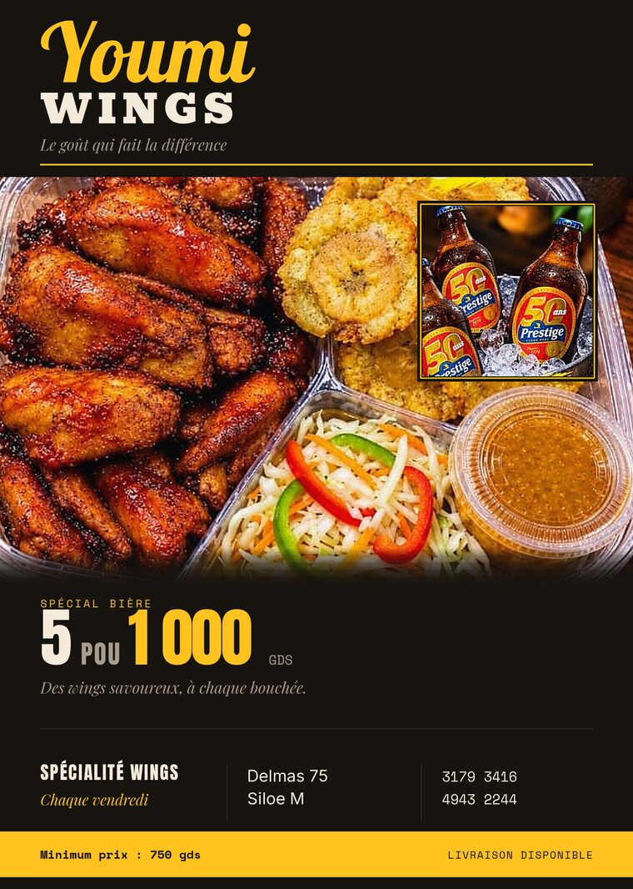
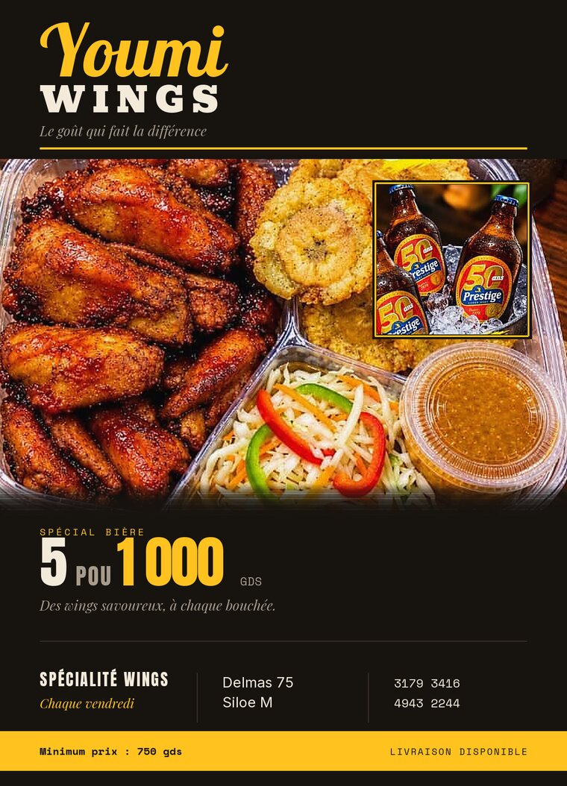
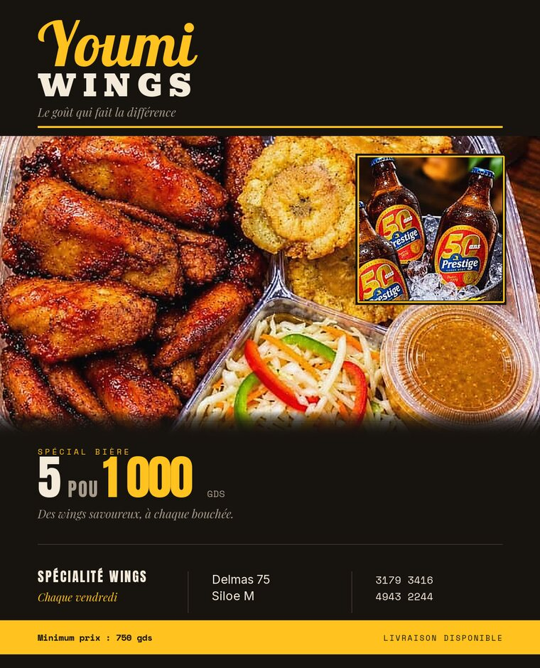
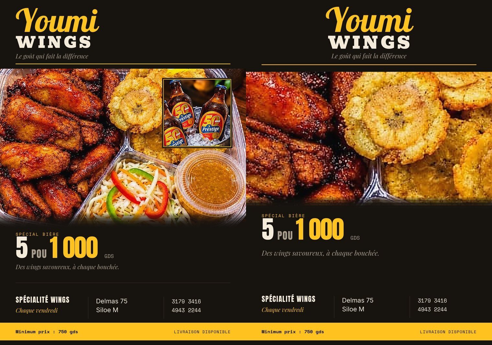
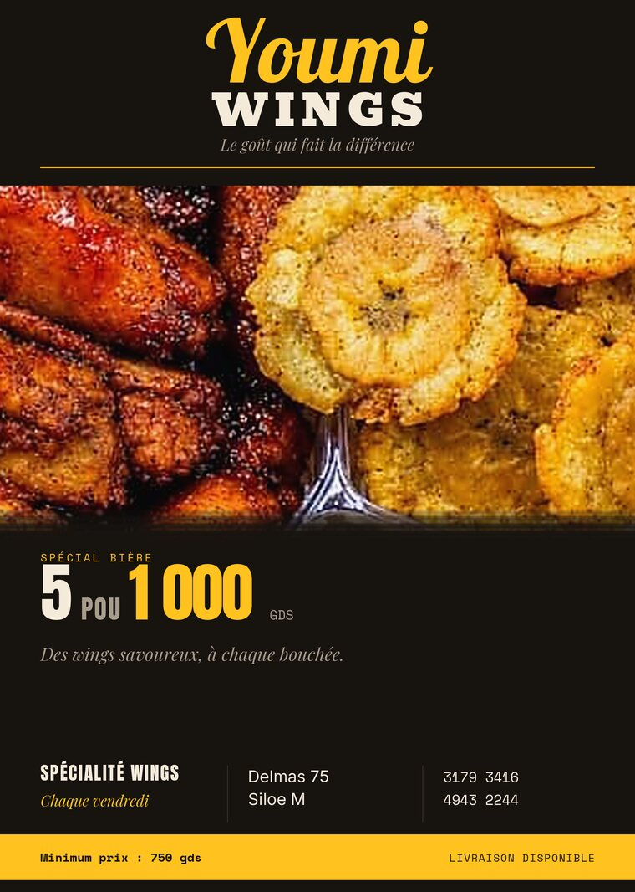
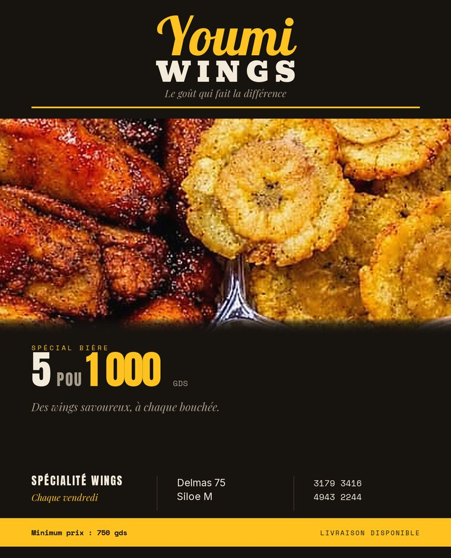
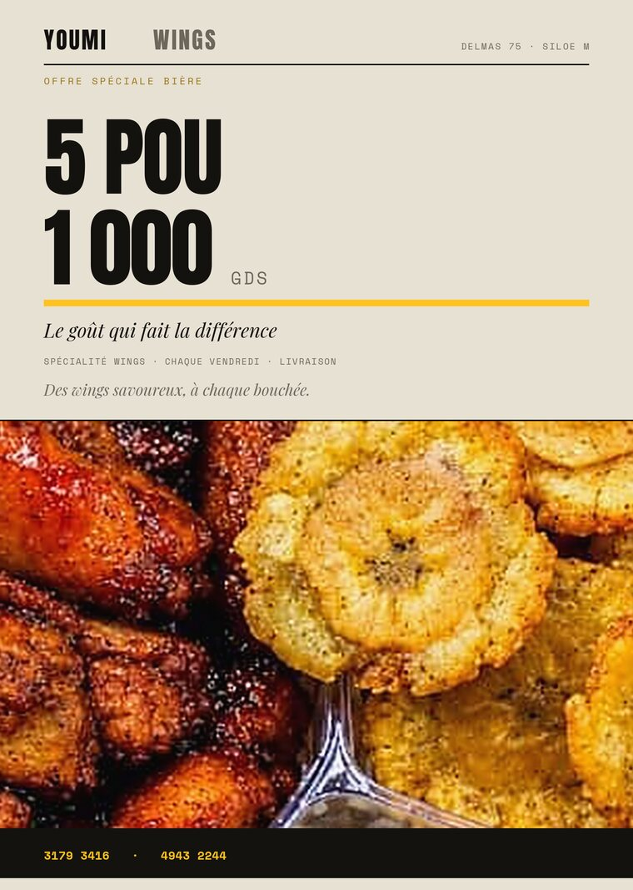
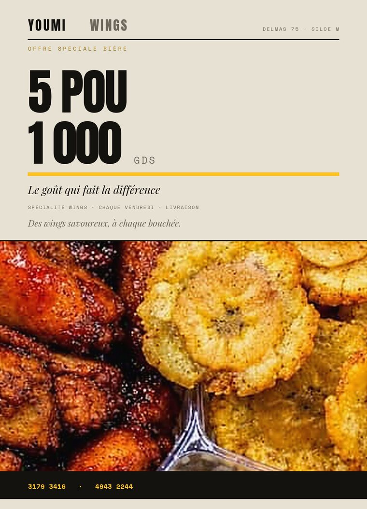
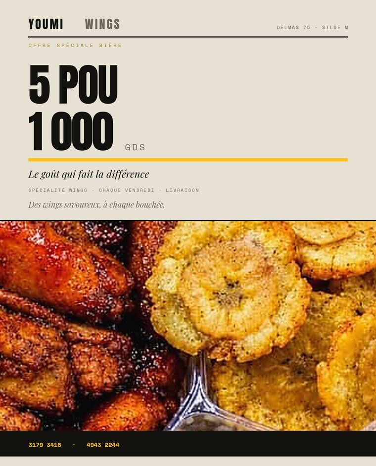

# Youmi Wings — planches de contrôle

Ouvre cette page sur ton téléphone : tout s'affiche ici, sans télécharger le PDF.

Pour l'impression, prends les PDF du dossier [`out/`](out/) — ce sont eux qui ont le fond perdu, le CMJN et les fontes embarquées. Les images ci-dessous ne sont que des aperçus à l'écran (RVB, 760 px de large).

---

## La direction retenue — v4, fond noir (A5)

[PDF print A5](out/youmi_v4_A5.pdf)

**A6 — 105 × 148 mm**

[PDF print A6](out/youmi_v4_A6.pdf)

**4:5 — social, 1080 × 1350**

[PDF print 4:5](out/youmi_v4_4x5.pdf)

### Ce qui a changé depuis le premier jet noir

- **Le plat occupe 100 mm de haut** au lieu de 74 et garde tout le visible : ailes, plantains, salade, sauce.
- **Les bières sont revenues**, en encart posé sur la photo avec un filet accent, pas en bloc flottant.
- Le prix respire (`5 POU 1 000 GDS`), la phrase est sur une seule ligne, l'information est ancrée en bas.

> ⚠️ Les bouteilles sont des **Prestige 50 ans**, une marque tierce. Elles apparaissent telles quelles dans la photo fournie. Pour une impression commerciale, il faut l'accord de Prestige, sinon il faudra les retirer ou les remplacer par un visuel de bière neutre. Dis-moi lequel et je refais l'encart.

---

## Les trois directions côte à côte (A5)

v4 (noir, retenue) à gauche, v2 (reprise) à droite.

---

## v2 — « Reprise »

Même architecture que ton flyer d'origine : wordmark en haut, photo en bande, gros prix, barre d'infos, bandeau jaune. Exécutée sur une vraie grille.

**A5 — 148 × 210 mm**

[PDF print A5](out/youmi_v2_A5.pdf)

**A6 — 105 × 148 mm**

[PDF print A6](out/youmi_v2_A6.pdf)

**4:5 — social, 1080 × 1350**

[PDF print 4:5](out/youmi_v2_4x5.pdf)

---

## v3 — « Studio », version claire (conservée pour comparaison)

Le chiffre fait tout le travail. Aucun badge, un seul filet accent.

**A5 — 148 × 210 mm**

[PDF print A5](out/youmi_v3_A5.pdf)

**A6 — 105 × 148 mm**

[PDF print A6](out/youmi_v3_A6.pdf)

**4:5 — social, 1080 × 1350**

[PDF print 4:5](out/youmi_v3_4x5.pdf)

---

## Ce qu'il faut regarder avant de choisir

1. **À 3 mètres** — réduis l'image à 15 % ou recule : quelle version accroche encore ? Sur les deux, c'est le mot `Youmi` ou le chiffre.
2. **Le pouce** — quelle version a le prix le plus vite lisible ?
3. **Le ton** — v2 est chaleureuse et commerciale, v3 est plus froide et plus chère. C'est un choix de positionnement, pas de goût.
4. **Le format réel** — si c'est pour un A3 en vitrine, aucune des deux ne suffit avec la photo actuelle (voir [NOTES.md](NOTES.md#limite-à-connaître--la-photo)).

## Notes techniques

- Chaque PDF fait **6 mm de plus** que le format annoncé : c'est le fond perdu de 3 mm par côté. Le format fini reste 148 × 210 pour un A5.
- Couleurs écrites en CMJN, fontes embarquées, texte cherchable.
- Il manque seulement l'*Output Intent* ICC (PDF/X-4) : une commande Ghostscript, documentée dans NOTES.md.
